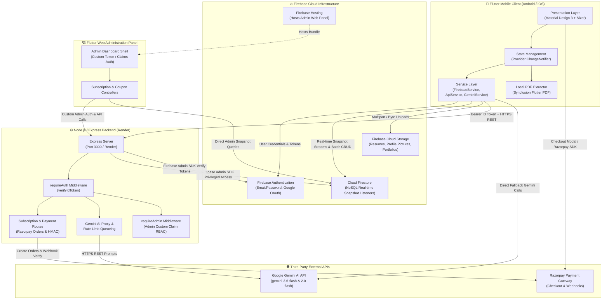
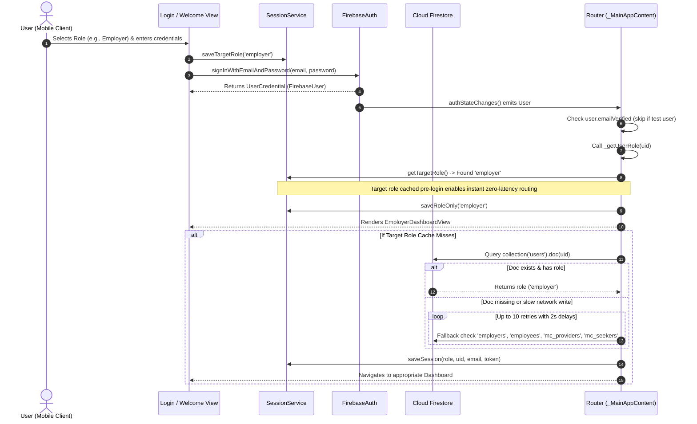
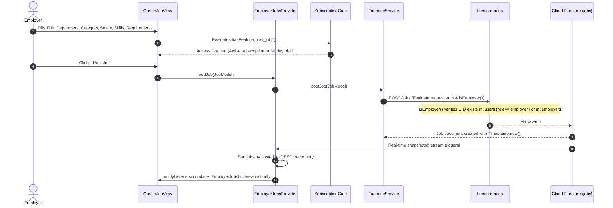
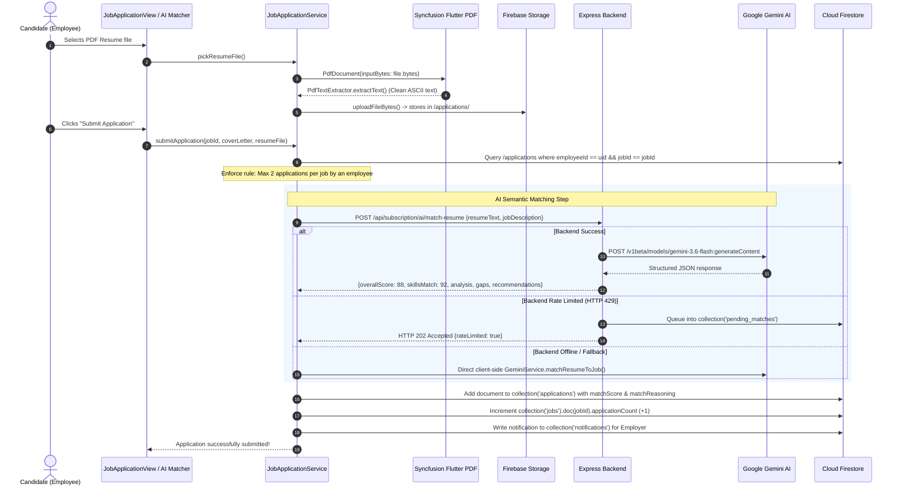
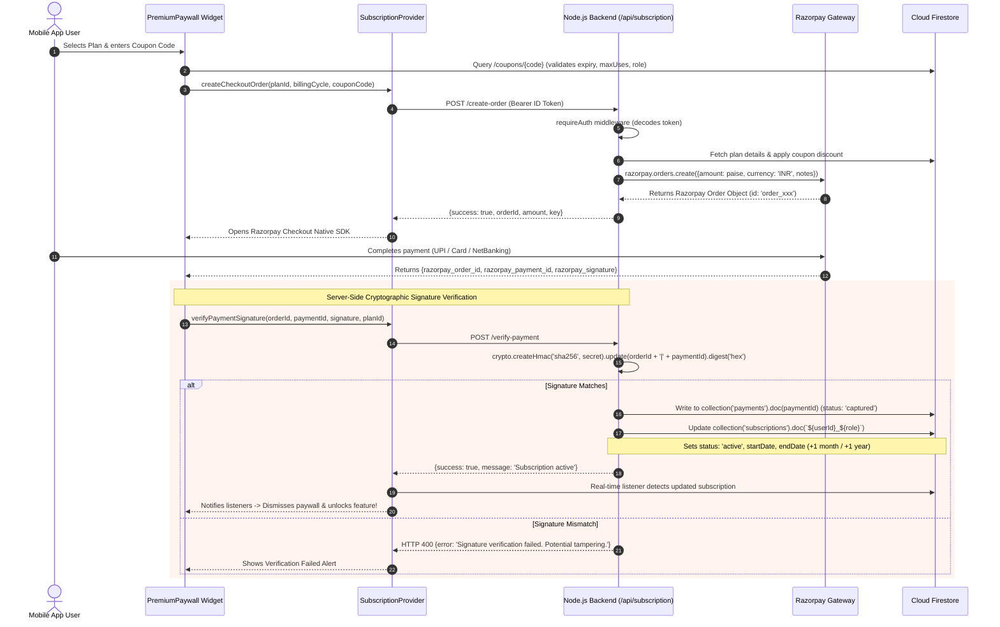
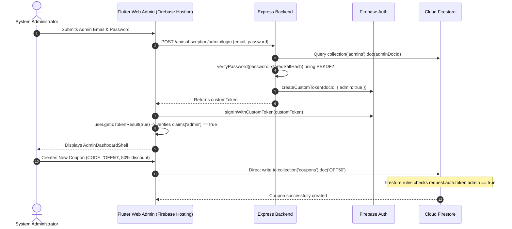

# 01 — System Architecture, Component Design & End-to-End Data Flows

---

## 🏛️ High-Level System Architecture

The LEO OPUS ecosystem follows a multi-tier, reactive client-server architecture. The mobile client communicates directly with **Firebase Cloud Services** for real-time operational data and authenticated file storage, while routing sensitive business transactions (Razorpay order creation, payment signature verification, and rate-limited AI resume evaluations) through a dedicated **Node.js/Express.js** micro-backend.

---

## 🧩 Component-Level Architecture

The Flutter codebase is structured around a **layered architectural pattern with separation of concerns**:

### 1. Presentation Layer (`lib/views/` & `lib/widgets/`)
- **Views:** Structured by business domain:
  - `lib/views/general/`: `WelcomeView`, `RoleOptionView`, `McRoleOptionView`, `EmailVerificationView`, `SplashScreen`.
  - `lib/views/employer/`: `EmployerDashboardView`, `CreateJobView`, `EmployerJobsListView`, `CandidatesView`, `EmployerAiResumeMatcher`.
  - `lib/views/employee/`: `EmployeeDashboardView`, `EmployeeJobsListView`, `EmployeeJobDetailsView`, `JobApplicationView`, `MyApplicationsView`, `EmployeeAiResumeMatcher`.
  - `lib/maintenance_contracts/views/`: Provider views (`mc_provider_dashboard_view.dart`, `mc_add_service_view.dart`, `mc_request_management_view.dart`) and Seeker views (`mc_seeker_dashboard_view.dart`, `mc_seeker_catalog_view.dart`, `mc_seeker_bookings_view.dart`).
- **Widgets:** Modular reusable UI elements: `AnimatedSplashScreen`, `CustomPopup`, `NetworkIndicator`, `StatCard`, `SubscriptionGate`, `PremiumPaywall`, `EmployeeDrawer`, `EmployerDrawer`.
- **Responsive UI Engine:** Wrapped in [`Sizer`](file:///d:/Shinnovation/leox/lib/main.dart#L143-L165) (`sizer: ^3.1.3`), converting hardcoded layout pixels into proportional viewport units (`.w`, `.h`, `.sp`), ensuring pixel-perfect scaling across phones and tablets.

### 2. State Management Layer (`lib/providers/` & `lib/maintenance_contracts/controllers/`)
- Utilizes the **Provider** package (`provider: ^6.1.5+1`) with `ChangeNotifier`.
- 14 distinct providers configured in [`MultiProvider`](file:///d:/Shinnovation/leox/lib/main.dart#L79-L115) at the root widget tree:
  - Global: `ThemeProvider`, `ConnectivityProvider`, `SubscriptionProvider`.
  - Employer: `EmployerAuthProvider`, `EmployerDashboardProvider`, `EmployerJobsProvider`, `EmployerCandidatesProvider`, `EmployerProfileProvider`.
  - Employee: `EmployeeAuthProvider`, `EmployeeDashboardProvider`, `EmployeeJobsProvider`, `JobApplicationProvider`, `NotificationProvider`, `AIResumeMatcherProvider`.
  - Maintenance Contracts: `McProviderAuthController`, `McSeekerAuthController`, `McProviderDashboardController`, `McSeekerDashboardController`.
- **Reactivity Model:** Providers maintain live Firestore snapshot subscriptions (`StreamSubscription<QuerySnapshot>`). When documents are modified remotely, snapshot callbacks update private lists and invoke `notifyListeners()`, triggering targeted widget subtree rebuilds.

### 3. Business Logic & AI Layer (`lib/backend/ai_workflows.dart` & `lib/services/gemini_service.dart`)
- **PDF Extraction:** Uses `syncfusion_flutter_pdf` on the mobile device. `PdfDocument(inputBytes: bytes)` parses binary streams in-memory and extracts clean text strings via `PdfTextExtractor`, avoiding heavy cloud bandwidth usage.
- **AI Matching Pipeline:** Implements a dual-tier resilience strategy:
  1. *Primary Route:* Calls backend `POST /api/subscription/ai/match-resume` with user auth token.
  2. *Secondary Fallback:* If the backend is unreachable or times out, directly invokes client-side `GeminiService.matchResumeToJob` using `google_generative_ai` SDK (`gemini-3.6-flash`, falling back to `gemini-2.0-flash`).
  3. *Rate Limiting Graceful Degradation:* If rate limited (HTTP 429), the backend returns HTTP 202 Accepted and writes to the `pending_matches` collection in Firestore, informing the user that their analysis is queued.

### 4. Service & API Layer (`lib/services/`)
- [`ApiService`](file:///d:/Shinnovation/leox/lib/services/api_service.dart): Centralized HTTP client wrapping `package:http`. Implements static REST verbs (`get`, `post`, `put`, `delete`), timeout handling (5 minutes for heavy AI requests), and unified status-code exception parsing (`ApiException`).
- [`FirebaseService`](file:///d:/Shinnovation/leox/lib/services/firebase_service.dart): Encapsulates direct Firestore operations for jobs, applications, and profiles.
- [`SessionService`](file:///d:/Shinnovation/leox/lib/services/session_service.dart): In-memory session cache backed by `SharedPreferences` to eliminate asynchronous race conditions during login/logout.
- [`StorageService`](file:///d:/Shinnovation/leox/lib/services/storage_service.dart): Cross-platform file upload handler supporting web (`putData`) and mobile (`putFile`) with automatic content-type resolution.
- [`ConnectivityService`](file:///d:/Shinnovation/leox/lib/services/connectivity_service.dart): Background listener monitoring network availability with broadcast streams.

### 5. Backend Layer (`backend/server.js` & `backend/routes/subscription.js`)
- Express.js microservice hosted on Render (`https://leox-kfsm.onrender.com/api`).
- **Middleware:** CORS with white-listed origins, JSON parsing (`10mb` limit for resumes), Multer memory storage (`5MB` file limit).
- **Security Middleware:**
  - `requireAuth`: Verifies incoming Firebase Bearer ID tokens via `admin.auth().verifyIdToken(token)`.
  - `requireAdmin`: Enforces Firebase Custom Claims (`decodedToken.admin === true`).
- **Crypto & Webhooks:** Uses Node.js `crypto` module for HMAC-SHA256 signature verification (`orderId + '|' + paymentId`) and handles Razorpay webhooks for payment failures and refunds.

### 6. Administration Web Portal (`web_admin/`)
- Standalone Flutter Web project hosted on Firebase Hosting (`studio-7488920972-4ef9c.web.app`).
- Reuses parent models (`SubscriptionPlanModel`, `SubscriptionModel`).
- Requires Firebase Custom Claims (`claims['admin'] == true`). Includes bootstrap mode for initial owner setup when zero admins exist.

---

## 🔄 End-to-End Request Flows (Traced through Actual Code)

### Flow 1: User Registration, Login & Role-Based Navigation

**Code Trace:**
1. User role selection in [`lib/views/general/role_option_view.dart`](file:///d:/Shinnovation/leox/lib/views/general/role_option_view.dart#L80-L86).
2. Credentials submitted to [`EmployerAuthProvider.signIn`](file:///d:/Shinnovation/leox/lib/providers/employer_auth_provider.dart).
3. Auth state stream observed in [`lib/main.dart`](file:///d:/Shinnovation/leox/lib/main.dart#L174-L281).
4. `_getUserRole` fast-path execution in `lib/main.dart` lines 287–312 using [`SessionService.getTargetRole()`](file:///d:/Shinnovation/leox/lib/services/session_service.dart#L34-L39).
5. 10-attempt retry loop with 2-second delays querying `users`, `employers`, `employees`, `mc_providers`, and `mc_seekers` collections (`lib/main.dart` lines 319–407).
6. Routing to `EmployerDashboardView`, `EmployeeDashboardView`, `McProviderDashboardView`, or `McSeekerDashboardView`.

---

### Flow 2: Creating and Managing a Hiring Job Posting

**Code Trace:**
1. Form validation and field capture in `lib/views/employer/create_job_view.dart`.
2. Feature authorization check in [`SubscriptionGate`](file:///d:/Shinnovation/leox/lib/widgets/subscription_gate.dart) querying [`SubscriptionProvider.hasFeature('post_jobs')`](file:///d:/Shinnovation/leox/lib/providers/subscription_provider.dart#L132-L193).
3. Call dispatched to [`EmployerJobsProvider.addJob`](file:///d:/Shinnovation/leox/lib/providers/employer_jobs_provider.dart#L91-L101).
4. Delegated to [`FirebaseService.postJob`](file:///d:/Shinnovation/leox/lib/services/firebase_service.dart#L18-L56).
5. Authorization enforced by `firestore.rules` lines 64–78 (`isEmployer()` rule).
6. Document stored with schema fields: `title`, `department`, `category`, `description`, `requirements`, `skills`, `postedBy`, `status: 'Open'`, `applicationCount: 0`.
7. Real-time snapshot listener in `EmployerJobsProvider.loadJobs()` lines 46–86 automatically updates list.

---

### Flow 3: Candidate Application & AI Resume Matching Workflow

**Code Trace:**
1. User triggers upload in [`lib/providers/ai_resume_matcher_provider.dart`](file:///d:/Shinnovation/leox/lib/providers/ai_resume_matcher_provider.dart#L40-L101).
2. Binary extraction via `PdfDocument` and `PdfTextExtractor` (`ai_resume_matcher_provider.dart` lines 69–82).
3. Application submission initiated in [`lib/services/job_application_service.dart`](file:///d:/Shinnovation/leox/lib/services/job_application_service.dart#L36-L100).
4. Validation rule: `existingSnapshot.docs.length >= 2` prevents duplicate spam (`job_application_service.dart` lines 57–65).
5. Storage upload via [`StorageService.uploadPlatformFile`](file:///d:/Shinnovation/leox/lib/services/storage_service.dart) to path `applications/${uid}_${jobId}_resume.ext`.
6. AI evaluation in [`AIWorkflows.matchResumeToJob`](file:///d:/Shinnovation/leox/lib/backend/ai_workflows.dart#L53-L113) with primary backend call and client-side `GeminiService` fallback.
7. Express route in [`backend/routes/subscription.js`](file:///d:/Shinnovation/leox/backend/routes/subscription.js#L942-L1044). On HTTP 429, writes to Firestore `pending_matches` collection (`queueId = match_${userId}_${Date.now()}`).
8. Application written to `applications` collection in Firestore with `matchScore` and `matchReasoning` (`job_application_service.dart` lines 247–250).
9. Employer notification generated via [`NotificationService`](file:///d:/Shinnovation/leox/lib/services/notification_service.dart).

---

### Flow 4: Subscription Checkout, Razorpay Payment & Cryptographic Verification

**Code Trace:**
1. User enters coupon and initiates checkout in [`lib/widgets/premium_paywall.dart`](file:///d:/Shinnovation/leox/lib/widgets/premium_paywall.dart#L230-L280).
2. Coupon validated against Firestore `/coupons/{code}` rules (`premium_paywall.dart` lines 152–228).
3. Order creation requested via [`SubscriptionProvider.createCheckoutOrder`](file:///d:/Shinnovation/leox/lib/providers/subscription_provider.dart#L196-L233).
4. Backend route [`POST /api/subscription/create-order`](file:///d:/Shinnovation/leox/backend/routes/subscription.js#L57-L240):
   - Decodes token via `requireAuth`.
   - Computes base price and coupon discounts (percentage or fixed INR).
   - Generates Razorpay Order via `razorpay.orders.create({amount: amountInPaise, currency: 'INR', receipt, notes})`.
5. Mobile client opens Razorpay SDK via `_razorpay.open(options)` in `premium_paywall.dart` lines 349.
6. On success callback `_handlePaymentSuccess`, dispatches credentials to [`SubscriptionProvider.verifyPaymentSignature`](file:///d:/Shinnovation/leox/lib/providers/subscription_provider.dart#L236-L279).
7. Backend verification route [`POST /api/subscription/verify-payment`](file:///d:/Shinnovation/leox/backend/routes/subscription.js#L246-L358):
   - Computes HMAC SHA-256: `crypto.createHmac('sha256', keySecret).update(orderId + '|' + paymentId).digest('hex')`.
   - Compares with `razorpaySignature`.
   - Persists payment document in `payments` collection with status `'captured'`.
   - Activates subscription in Firestore collection `subscriptions` doc `${userId}_${role}` with updated `endDate`.
8. Firestore snapshot listener in `SubscriptionProvider.listenToSubscription()` automatically refreshes subscription state on the client, unlocking gated features.

---

### Flow 5: Web Admin Plan & Coupon Management

**Code Trace:**
1. Admin login screen in [`web_admin/lib/main.dart`](file:///d:/Shinnovation/leox/web_admin/lib/main.dart#L191-L250).
2. Verification endpoint [`POST /api/subscription/admin/login`](file:///d:/Shinnovation/leox/backend/routes/subscription.js#L551-L591):
   - Checks document in Firestore `admins` collection.
   - Verifies password using PBKDF2: `crypto.pbkdf2Sync(password, salt, 1000, 64, 'sha512')`.
   - Generates Firebase Custom Token with claim `{ admin: true }` via `admin.auth().createCustomToken(docId, { admin: true })`.
3. Web client authenticates via `FirebaseAuth.instance.signInWithCustomToken()`.
4. `AuthWrapper` inspects `getIdTokenResult()` claims (`web_admin/lib/main.dart` lines 161–184).
5. Authorized admin directly writes to `subscription_plans` and `coupons` collections, permitted by `firestore.rules` line 138 (`isAdmin()`).
